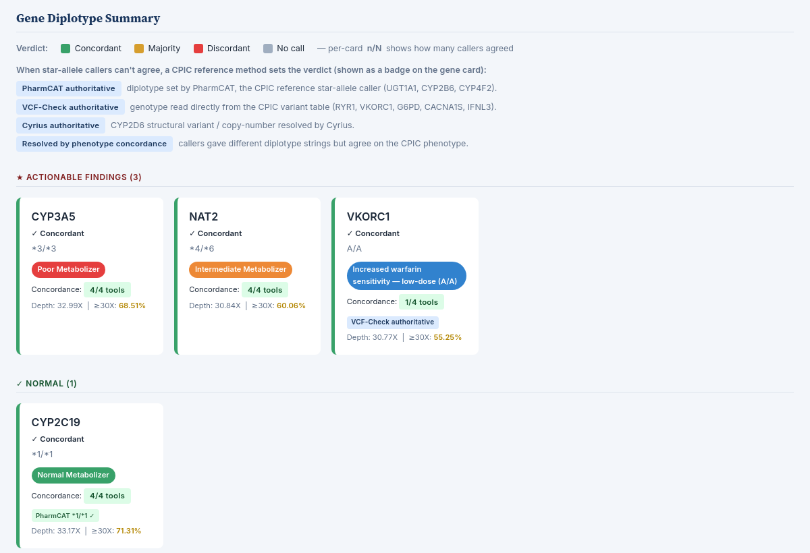
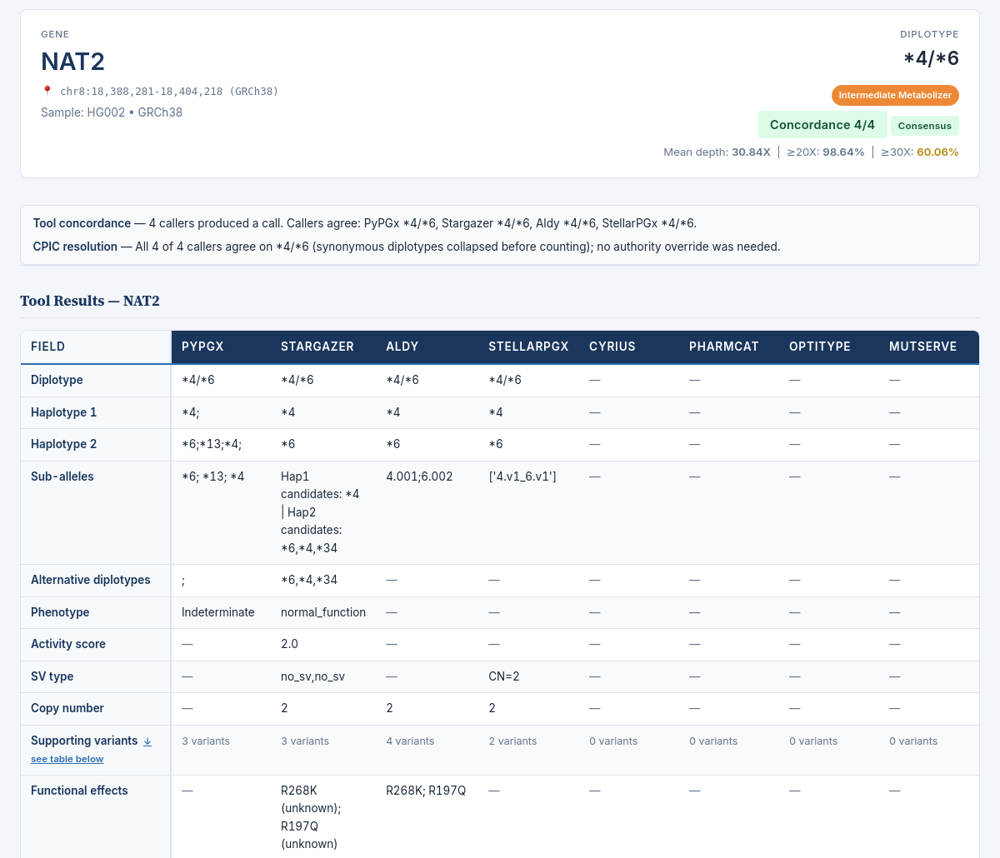

# PGx Suite

[](https://github.com/alvin8-git/pgx-suite/actions/workflows/test.yml)

PGx Suite calls pharmacogenomic genotypes (star alleles, single variants, HLA types, ABO, MT-RNR1)
from one GRCh38 whole-genome BAM or CRAM. It runs several published callers on each gene from one
Docker image, reconciles their calls into one verdict per gene, and writes a self-contained HTML
report plus TSV and JSON files. The workflow engine is Nextflow (default) or Snakemake; both give the
same results.

> **Research and educational use only.** PGx Suite is not a medical device and its output is not a
> diagnostic result. Do not use it to make treatment decisions.

## Quick start

```bash
git clone --recurse-submodules https://github.com/alvin8-git/pgx-suite.git
cd pgx-suite
# put the reference data in place first (see Reference data): the build needs the Stargazer panels
docker build --build-arg PGX_VERSION=$(git rev-parse --short HEAD) -t pgx-suite:latest .
tests/smoke/run.sh                                      # 4 genes on a 6.6 MB HG002 slice; prints PASS lines
./run_pgx_suite.sh /path/to/sample.bam --jobs 16        # one whole genome -> results/<sample>/
```

Open `results/<sample>/<sample>_pgx_report.html` in a browser; it works offline.

## What it does and does not do

**Does**
- Types 42 genes and loci listed in [`docker/genes.tsv`](docker/genes.tsv): CYP2D6, CYP2C19, CYP2C9,
  DPYD, TPMT, NUDT15, UGT1A1, SLCO1B1, HLA-A/B/C, HLA-DQA1/DQB1/DRB1, MT-RNR1, ABO and others.
- Runs up to 12 methods per sample: PyPGx, Stargazer, Aldy, StellarPGx (star alleles); Cyrius,
  PharmCAT, VCF-Check (authority methods for named genes); OptiType, arcasHLA, T1K (HLA); an ABO
  read pileup; mutserve (MT-RNR1).
- Reconciles the calls in fixed tiers (Figure 2) and records which method decided each verdict.
- Refuses to call when it should not: genes below a depth floor are `no_call`, and paralog genes
  (CYP2D6, CYP2A6, CYP2B6, GSTM1, GSTT1) are `no_call` when the BAM was not aligned ALT-aware.
- Writes a provenance record (tool versions, reference size and contig count, genes assessed).
- Per-gene tool support: [`docs/gene-coverage.md`](docs/gene-coverage.md).

**Does not**
- Align reads or call genome-wide variants. Input must already be aligned to GRCh38 with bwa-mem.
- Support GRCh37/hg19.
- Resolve every structural allele. Some CYP2D6 hybrids and tandems need long reads; see
  [Known limits](#known-limits).
- Give dosing advice that has been validated for clinical use.

## Pipeline



*Figure 1. The pipeline, simplified. Each caller is one step (a Nextflow process, or a Snakemake rule)
whose output is a status file holding the tool's exit code, so one failing tool is marked `failed` and
the run continues. Source: [`docs/img/fig1_pipeline.mmd`](docs/img/fig1_pipeline.mmd).*



*Figure 2. How `docker/pgx-compare.py` turns the callers' outputs into one verdict per gene.
Authority methods: Cyrius for CYP2D6; PharmCAT for UGT1A1, CYP2B6, CYP4F2; VCF-Check for RYR1,
VKORC1, IFNL3, G6PD, CACNA1S, CYP2C-CLUSTER and ABO. Source:
[`docs/img/fig2_verdict.mmd`](docs/img/fig2_verdict.mmd).*

**Two engines, one result.** [`main.nf`](main.nf) (Nextflow, the default) and
[`docker/Snakefile`](docker/Snakefile) (Snakemake) run the same commands in the same image. Nextflow
runs each step in its own container and can resume a stopped run; Snakemake runs everything in one
container. On GIAB HG001 to HG007 with all genes, the Nextflow output equals a Snakemake run file for
file ([validation](docs/nextflow-port-plan.md#validation-results)).

## Where it sits in the OmniGen suite

| Repository | Role |
|---|---|
| [OmniGen](https://github.com/alvin8-git/OmniGen) | Grades and renders the combined report. Calls no variants; reads the three repos below. |
| **pgx-suite** (this repo) | Medicine response (pharmacogenomics), HLA, ABO blood group. |
| [SVcaller](https://github.com/alvin8-git/SVcaller) | Structural variants, copy number, SMN, alpha-globin, repeat expansions. |
| [poly-suite](https://github.com/alvin8-git/poly-suite) | Polygenic scores, ancestry. |

OmniGen reads `pharmcat/pgx.report.json`, `all_genes_summary.tsv`, the per-gene `detail.json` files
and the ABO/HLA class II contract files. Keep their schemas stable.

## Requirements

| Item | Needed | Checked here |
|---|---|---|
| OS | Linux x86-64 with Docker Engine; `docker run --privileged` must be allowed (Apptainer runs inside the container for StellarPGx, OptiType, PharmCAT and arcasHLA). Containers run as your own uid:gid, not root: `run_pgx_suite.sh` passes `--user`, mounts a generated `/etc/passwd` and `/etc/group` read-only (this user plus root, from `getent`; Apptainer fails with "unknown userid" otherwise) and sets `HOME=/tmp` (`docker/run_as_user.sh`). `OG_DOCKER_USER` overrides: `--user ...` is used as-is, `uid[:gid]` gets `--user` prepended; set it empty to run as root (outputs then become root-owned). A results folder holding root-owned files from an earlier run stops the launch with the `chown` to run | Ubuntu, kernel 5.15 |
| Docker image | built from this repo | 1.95 GB |
| Nextflow engine (default) | Java 17 or later on the host. The `./nextflow` launcher in the repo fetches Nextflow on first use; `main.nf` needs 25.10 or later | OpenJDK 17.0.10, Nextflow 25.10.4 |
| Snakemake engine | nothing on the host: Snakemake 9.23.0 is inside the image (pinned in the Dockerfile) | yes |
| CPU | `--jobs N` sets the CPUs used (default 4) | 16 per run in the validation |
| RAM | the largest steps declare 8 GB (HLA class II, Aldy); Stargazer 4 GB, PyPGx 6 GB. Every step has a base memory and is retried with 2x and then 3x of it, up to `--max_memory` (default 32 GB), when it is killed (exit 134, 137 or 143); a step still killed after the retries stops the run. A time-limit kill (140) is not retried: raise `--max_time` | measured per step (trace) |
| Disk | image 2 GB + resources about 6 GB (table below) + about 45 MB output per sample; Nextflow also keeps a work folder per sample | yes |
| Input | GRCh38 BAM or CRAM with index, aligned by bwa-mem against a reference with ALT contigs | yes |

## Installation

```bash
git clone --recurse-submodules https://github.com/alvin8-git/pgx-suite.git
cd pgx-suite
# copy the Stargazer panels into stargazer-grc38-2.0.3/stargazer/1kgp_vcf/grc38/ (see Reference data)
docker build --build-arg PGX_VERSION=$(git rev-parse --short HEAD) -t pgx-suite:latest .
source docker/run_as_user.sh && pgx_user_opts   # non-root, as docker/test.sh expects
docker run --privileged $PGX_USER_OPTS --rm pgx-suite:latest bash /opt/pgx/test.sh   # tool checks, no data needed (a few minutes)
```

The build stops with an error if the Stargazer panels are missing; an image without them would
report Stargazer as failed on every gene. A no-cache build from a fresh clone took 4 minutes here.

The `pypgx` submodule is [alvin8-git/pypgx](https://github.com/alvin8-git/pypgx), branch
`pgx-suite-patches`: upstream PyPGx 0.26.0 plus three pandas 2.x fixes. Already cloned without
submodules? Run `git submodule update --init --recursive`.

`test.sh` prints `Results: 21 PASSED | 2 FAILED`, with 4 checks skipped because no SIFs are mounted.
The two failures (`omnigen_addons imports`, `abo_allele_defs.json UNVALIDATED`) are out-of-date
assertions in `docker/test.sh` after the ABO typer changed; the ABO unit test
`docker/test_omnigen_addons.py` passes.

The image contains non-commercial tools (see [Licence](#licence)): keep it in a private registry or
move it as a file (`docker save pgx-suite:latest | gzip > pgx-suite.tar.gz`, then `docker load`).

## Reference data

All of these live outside git (`.gitignore`). The build, the launcher and the smoke test expect them
at fixed paths under the repo root.

| Path in the repo | Contents | Size |
|---|---|---|
| `stargazer-grc38-2.0.3/stargazer/1kgp_vcf/grc38/` | Stargazer 2.0.3 phasing panels, 62 `.vcf.gz` files; **needed to build the image**. From the Stargazer 2.0.3 distribution ([stargazer.gs.washington.edu/stargazerweb](https://stargazer.gs.washington.edu/stargazerweb), non-commercial licence): copy its `stargazer/1kgp_vcf/grc38/` folder here | 189 MB |
| `GRCh38/hg38.fa`, `hg38.fa.fai` | GRCh38 with ALT contigs (455 contigs), the reference the BAM was aligned to | 3.1 GB |
| `pypgx/pypgx-bundle/` | PyPGx resource bundle, version 0.26.0 | 500 MB |
| `StellarPGx/containers/stellarpgx-dev.sif` | StellarPGx tools | 32 MB |
| `StellarPGx/containers/pharmcat.sif` | PharmCAT 3.2.0 | 1.86 GB |
| `StellarPGx/containers/optitype.sif` | OptiType 1.3.5 | 150 MB |
| `StellarPGx/containers/arcashla.sif` | arcasHLA 0.6.0 + IMGT/HLA + kallisto 0.44.0 | 473 MB |
| `StellarPGx/containers/t1k_hlaidx/` | T1K HLA index (optional; without it HLA class II is single-typer) | about 110 MB |

### Shared bundle (link not yet published)

The OmniGen suite will ship these files in one archive. **The link is not published yet.**
pgx-suite needs only the Stargazer panels, the reference FASTA, the PyPGx bundle and the SIFs listed above.

### Building each item from public sources

Commands marked *not run here* were not executed while writing this README.

```bash
# GRCh38 + ALT contigs: use the FASTA your BAM was aligned to, then index it.
samtools faidx GRCh38/hg38.fa

# PyPGx bundle (matches PyPGx 0.26.0)                                   # not run here
git clone --branch 0.26.0 --depth 1 https://github.com/sbslee/pypgx-bundle pypgx/pypgx-bundle

# One-off SIF builds below stay root: apptainer build/pull and the apptainer.conf edit need it, and the
# SIFs are not part of a sample run. chown them to your user afterwards.
# StellarPGx SIF from the upstream Docker Hub image (unpinned upstream tag) # not run here
docker run --privileged --rm -v "$PWD/StellarPGx/containers:/pgx/containers" pgx-suite:latest \
  apptainer build /pgx/containers/stellarpgx-dev.sif docker://twesigomwedavid/stellarpgx-dev:latest

# OptiType SIF                                                           # not run here
docker run --privileged --rm -v "$PWD/StellarPGx/containers:/pgx/containers" pgx-suite:latest \
  apptainer pull --name /pgx/containers/optitype.sif \
  docker://quay.io/biocontainers/optitype:1.3.5--hdfd78af_1
```

**PharmCAT SIF.** Apptainer's multithreaded `mksquashfs` corrupted this 1.8 GB image on the
development host; force one thread and use a real disk for the temp directory (*not run here*):

```bash
mkdir -p "$PWD/apptmp"
docker run --privileged --rm -v "$PWD/StellarPGx/containers:/pgx/containers" -v "$PWD/apptmp:/apptmp" \
  -e APPTAINER_TMPDIR=/apptmp -e APPTAINER_CACHEDIR=/apptmp -e TMPDIR=/apptmp pgx-suite:latest bash -lc '
  sed -i "s/^mksquashfs procs = 0/mksquashfs procs = 1/" /etc/apptainer/apptainer.conf
  apptainer pull --name /pgx/containers/pharmcat.sif docker://pgkb/pharmcat:latest'
```

**arcasHLA SIF** cannot be a plain pull (the biocontainer has no IMGT/HLA reference and a kallisto
version arcasHLA 0.6.0 cannot read). Build it with
[`docker/build-arcashla-sif.sh`](docker/build-arcashla-sif.sh); inputs are listed in
[`docs/ToolsDocumentation.md`](docs/ToolsDocumentation.md) section 5b. The T1K index is built with
[`docker/build-t1k-index.sh`](docker/build-t1k-index.sh) (section 5c).

## Smoke test

[`tests/smoke/data/HG002.smoke.bam`](tests/smoke/data/) is a 6.6 MB slice of a 30x GIAB HG002
(NA24385) GRCh38 BAM: four genes (CYP2C19, CYP3A5, NAT2, VKORC1), the copy-number control regions
Aldy and StellarPGx read, and 10 kb of an ALT contig. Read names are replaced and the header carries
no paths. [`tests/smoke/make_slice.sh`](tests/smoke/make_slice.sh) rebuilds it from any HG002 GRCh38
BAM.

```bash
tests/smoke/run.sh                       # Nextflow; reference from ./GRCh38
ENGINE=snakemake tests/smoke/run.sh      # the same check on Snakemake
IMAGE=pgx-suite:<tag> tests/smoke/run.sh # another image
```

It runs the pipeline on the slice, compares status, diplotype and caller agreement with
[`tests/smoke/expected.tsv`](tests/smoke/expected.tsv) (the same values as the full-genome HG002
run), then checks the ALT-awareness result and that the HTML report exists. Exit 0 means all values
matched, 1 a mismatch, 2 a pipeline or setup failure. Expected output:

```
PASS  CYP2C19  concordant *1/*1 4 4
PASS  CYP3A5   concordant *3/*3 4 4
PASS  NAT2     concordant *4/*6 4 4
PASS  VKORC1   concordant A/A 1 4
PASS  altcheck alt_aware=yes
smoke (nextflow): 53 s, output in <repo>/results/smoke/HG002
```

Run time on an idle host, 4 cores: 53 to 62 s on Nextflow (it starts one container per step), 46 to 47 s on
Snakemake.

**Not covered by the smoke test:** Cyrius and CYP2D6, PharmCAT-authority genes, HLA (OptiType,
arcasHLA, T1K), ABO, MT-RNR1, copy-number genes, CRAM input, and BAM-level QC numbers (on a slice
the report's BAM QC panel shows zero depth and read length; per-gene depth is correct).

## Usage

### `run_pgx_suite.sh` (recommended)

```
./run_pgx_suite.sh <BAM|CRAM> [--output DIR] [--jobs N] [--image NAME] [--engine nextflow|snakemake] [--resume]
```

| Option | Default | Meaning |
|---|---|---|
| `<BAM\|CRAM>` | required, first argument | Indexed input (`.bai`/`.crai` next to it) |
| `--output DIR` | `<repo>/results` | Parent folder; results go to `DIR/<SAMPLE>/` |
| `--jobs N` | 4 | CPUs to use |
| `--image NAME` | `pgx-suite:latest` | Docker image |
| `--engine` | `nextflow` | `snakemake` runs the Snakefile in one container instead |
| `--resume` | off | Nextflow only: reuse the finished steps of an earlier run of the same sample |

The sample name is the file name up to the first dot. The launcher checks the index, the resource
folders, the image and (for Nextflow) Java, then runs the pipeline. Nextflow keeps its log and work
folder in `DIR/.nextflow-run/<SAMPLE>/`; delete it after a successful run to free space.
Run the script with no arguments to see the usage text.

**Worked example (GIAB HG002, 30x, full genome, 16 CPUs).** Nextflow took 1075 s and Snakemake
1340 s and 1203 s in two runs, with other runs sharing the host. Calls include CYP2D6 `*2/*4`
(Cyrius authority), CYP3A5 `*3/*3`, NAT2 `*4/*6`, CYP2C19 `*1/*1`, HLA-A `*01:01/*26:01`, HLA-B
`*35:08/*38:01`, ABO `ABO*O/ABO*O`, 42 genes assessed.

### Nextflow directly

```bash
./nextflow run main.nf -profile docker --bam /path/HG002.bam --sample HG002 \
    --ref "$PWD/GRCh38/hg38.fa" --pgx_image pgx-suite:latest --outdir results
./nextflow run main.nf -profile test,docker --pgx_image pgx-suite:latest   # the smoke-test slice
```

Parameters (from [`nextflow.config`](nextflow.config)):

| Parameter | Default | Meaning |
|---|---|---|
| `--bam` | required | Indexed BAM or CRAM (host path) |
| `--sample` | required | Sample name used in file names |
| `--ref` | required | GRCh38 FASTA with `.fai`, the one the BAM was aligned to |
| `--genes` | all 42 | Subset, space- or comma-separated, e.g. `--genes "CYP2D6 NAT2"` |
| `--depth_bam` | same as `--bam` | For CRAM: a region BAM in the same folder, used for depth |
| `--sex` | unset | `MALE` or `FEMALE` (G6PD); otherwise inferred |
| `--min_depth` | 10 | Mean depth below which a gene is `no_call` |
| `--outdir` | `results` | Results go to `<outdir>/<sample>/` |
| `--pgx_image` | `pgx-suite:latest` | Docker image |
| `--max_cpus` | 8 | CPUs for the whole run (and the cap for any one step) |
| `--max_memory`, `--max_time` | 32 GB, 24 h | Caps for any one step |
| `--pypgx_bundle`, `--stellarpgx_dir`, `--containers_dir` | under the repo | Resource folders |

Add `-resume` to rerun only what changed. One sample per run. `-resume` does not notice a change that
only reorders a step's input files; after editing the merge order in `main.nf`, run without it.

### Snakemake directly

```bash
source docker/run_as_user.sh && pgx_user_opts   # sets $PGX_USER_OPTS: --user uid:gid, generated passwd/group, HOME=/tmp
docker run --privileged $PGX_USER_OPTS --tmpfs /pgx:mode=0777 --rm \
  -v "$PWD/StellarPGx:/pgx/stellarpgx" -v "$PWD/StellarPGx/containers:/pgx/containers" \
  -v "$PWD/pypgx/pypgx-bundle:/pgx/bundle" -v "$PWD/GRCh38:/pgx/ref:ro" \
  -v "/path/to/bams:/pgx/data:ro" -v "$PWD/results/HG002:/pgx/results" \
  pgx-suite:latest \
  snakemake -s /opt/pgx/Snakefile --cores 8 \
    --config bam=/pgx/data/HG002.bam outdir=/pgx/results sample=HG002
```

`--config` keys (from [`docker/Snakefile`](docker/Snakefile)):

| Key | Default | Meaning |
|---|---|---|
| `bam` | required | Input BAM or CRAM inside the container |
| `outdir` | `/pgx/results` | Output folder |
| `ref` | `/pgx/ref/hg38.fa` | Reference FASTA |
| `sample` | `@RG SM` tag, else file name | Sample name used in file names |
| `genes` | all 42 | Space-separated subset, e.g. `genes="CYP2D6 CYP2C19"` |
| `min_depth` | 10 | Mean depth below which a gene is `no_call` |
| `depth_bam` | same as `bam` | For CRAM: a region BAM cut with `docker/pgx_cram_regions.bed`, used for depth |
| `sex` | unset | Passed to `pgx-compare.py --sex` (G6PD) |
| `genes_tsv` | `/opt/pgx/genes.tsv` | Alternative gene table |

### Behaviour common to both engines

- The run stops before any caller if `samtools quickcheck` fails on the input or a gene's contig is
  missing from the reference index.
- It fails at the end (`.sanity_ok` not written, exit 1) if more than 60% of genes are `no_call`;
  the report is still written for inspection.
- After the main PharmCAT run, the OptiType HLA-A/B calls and an agreed CYP2D6 call are passed back
  to PharmCAT as outside calls; the rules are in
  [`docs/pharmcat-outside-calls.md`](docs/pharmcat-outside-calls.md). Re-run only that step for an
  existing sample (inside the image): `pgx-pharmcat-outside.sh /pgx/results/<SAMPLE>`.
- PharmCAT's call for each gene it reports is added to that gene's `detail.json` as an informational
  cross-check (`cross_check.PharmCAT`); it never changes the verdict.

## Outputs

```
<outdir>/<SAMPLE>/
├── <SAMPLE>_pgx_report.html        self-contained report, opens offline
├── all_genes_summary.tsv           one row per gene: Status, ConsensusDiplotype, ConsensusPhenotype, nAgree, nCalled, MeanDepth, HLA class II columns, DecidedBy
├── provenance.json                 tool versions, reference size and contigs, genes assessed, PharmCAT outside calls
├── bam_stats.json                  BAM QC and per-gene depth
├── alt_aware.json                  ALT-awareness decision and the evidence for it
├── .sanity_ok                      written only when at most 60% of genes are no_call
├── pipeline_info/                  Nextflow only: trace.txt, timeline.html, report.html
├── pharmcat/
│   ├── pgx.report.json             PharmCAT report incl. per-drug CPIC recommendations (read by OmniGen)
│   ├── pgx.report.no_outside.json  same, before HLA/CYP2D6 outside calls were added
│   ├── outside_calls.tsv           outside calls passed to PharmCAT and why
│   └── pharmcat.status, outside.status
├── optitype/                       one OptiType run for HLA-A/B/C
├── hla2/                           arcasHLA (+ T1K) class II typing; <SAMPLE>.hla2_consensus.json
├── abo/abo_type.tsv, abo_type.json ABO call and per-site reads
└── genes/<GENE>/
    ├── <GENE>_<SAMPLE>_comparison.tsv   one row per caller: Diplotype, ActivityScore, Phenotype, Status
    ├── <GENE>_<SAMPLE>_detail.json      17 fields per caller + the verdict block (status, authority, phenotype tier)
    ├── <GENE>.vcf.gz                    bcftools calls over the gene region
    ├── logs/<tool>.status               each caller's exit code
    └── pypgx/ stargazer/ aldy/ stellarpgx/ cyrius/   raw caller outputs
```



*Figure 3. Gene summary of the report, from the smoke-test run on HG002. Card colour follows the
verdict; the badge names the authority method (VCF-Check for VKORC1).*



*Figure 4. NAT2 detail page from the same run: verdict, agreement count, and the per-caller field
table.*

A full-genome example report is checked in at
[`docs/demo/HG002_report.html`](docs/demo/HG002_report.html) (download and open). It was built
before the latest changes; its HLA class II and ABO section uses labelled placeholder values.

## Validation

| Check | Truth | Result | Record |
|---|---|---|---|
| Engine equivalence | Snakemake, two runs per sample, GIAB HG001 to HG007, all genes | Nextflow output equals a Snakemake run file for file on all 7 samples (0 differences); remaining run-to-run differences are tool nondeterminism, listed by [`tests/compare_runs.py`](tests/compare_runs.py) | [`docs/nextflow-port-plan.md`](docs/nextflow-port-plan.md#validation-results) |
| Array comparison | Thermo Fisher Axiom PGx array, 13 samples on 2 sequencing platforms (26 pairs, 330 gene calls) | 241/330 (73.0%) verdict matches the array; 283/330 (85.8%) after counting array panel gaps and notation differences | [`docs/AxiomValidation.md`](docs/AxiomValidation.md) |
| Reference cell line | CDC GeT-RM consensus for GIAB HG001 (NA12878) | 19/28 genes exact match, 3 partial, 6 mismatch | [`docs/CHANGES.md`](docs/CHANGES.md) |
| ABO | GIAB v4.2.1 benchmark genotypes at the ABO sites, HG001 to HG007, plus Mendelian inheritance | 7/7 match; both trios consistent | [`docs/ToolsDocumentation.md`](docs/ToolsDocumentation.md) 5e |
| HLA class II | Published HG001 typing (Nariai et al. 2015); inheritance for HG002 to HG007 | HG001 matches at 1 or 2 fields; 21/21 gene calls agree between arcasHLA and T1K | ToolsDocumentation 5e |
| Unit tests | `docker/test_*.py` (13 scripts) and `pgx_altcheck.py --selftest` | all pass; CI runs 10 of the 13 (not `test_hla2_consensus`, `test_normalise`, `test_omnigen_addons`) | [`.github/workflows/test.yml`](.github/workflows/test.yml) |

### Known limits

- **Depth floor:** genes with mean depth below 10x are `no_call`.
- **Alignment:** BAMs aligned without ALT awareness (for example minimap2, or a reference without ALT
  contigs) give `no_call` for paralog genes; SNP genes are still reported.
- **CYP2D6:** some complex hybrid and tandem structures are not resolved from short reads
  ([`docs/AxiomValidation.md`](docs/AxiomValidation.md)).
- **HLA class II third field** is not reproducible run to run (arcasHLA); the two-field consensus is.
- **ABO:** A1/A2 and O subtypes are not resolved; an uncovered c.261 site gives `Not typed`.
- **GSTT1** sits on an ALT contig and has no bcftools VCF; UGT2B17 was dropped (whole-gene deletion).
- **Exomes:** see [`docs/wes-limitations.md`](docs/wes-limitations.md).

## Troubleshooting

Only problems recorded in this repo's docs and history.

| Symptom | Cause | Fix |
|---|---|---|
| `docker build` fails copying `pypgx/` | submodules not checked out | `git submodule update --init --recursive` |
| `docker build` stops: `1kgp_vcf/grc38/ is missing` | Stargazer panels not copied | see [Reference data](#reference-data) |
| Stargazer `failed` on every gene | image built before the build check, without the panels | rebuild with the panels in place |
| `'java' not found in PATH` | Nextflow needs Java 17+ | install Java, or use `--engine snakemake` |
| CYP2D6 and other paralog genes `no_call`, "not ALT-aware" banner | BAM aligned without ALT contigs or with minimap2 | Re-align with bwa-mem against GRCh38 with ALT contigs and the `.alt` file |
| `FATAL: could not open image` | SIF folder not mounted | Keep the SIFs in `StellarPGx/containers/` (mounted at `/pgx/containers`) |
| PharmCAT pull fails with SIGSEGV or "Bug in orderer" | multithreaded `mksquashfs` | Use `mksquashfs procs = 1` (see above) |
| HLA class II reported `failed` | `arcashla.sif` missing | Build it with `docker/build-arcashla-sif.sh` |
| HLA class II `single_typer` | no T1K index | Build it with `docker/build-t1k-index.sh` |
| Stargazer finds no data | Stargazer deletes its own output folder on start | the pipeline writes the GDF outside that folder; keep it that way |
| Slow or zero read length in BAM QC for CRAM | mosdepth on a full CRAM | pass a region BAM (`--depth_bam`, Snakemake `depth_bam=`) |
| Run exits 1 with `SANITY FAIL` | more than 60% of genes `no_call`: wrong reference, unreadable BAM, or low coverage | check the report and `bam_stats.json` |

## Contributing

See [`CONTRIBUTING.md`](CONTRIBUTING.md). Gene support is driven by one table,
[`docker/genes.tsv`](docker/genes.tsv) ([how to add a gene](docs/howto-add-a-gene.md)). A change to
the pipeline must keep the two engines equivalent: run both on a sample and compare with
`python3 tests/compare_runs.py <snakemake_result> <nextflow_result>`.

## Licence

**This repository has no licence file yet.** The owner has not chosen one, so no rights are granted
beyond viewing on GitHub.

The repository and the image contain third-party code with its own terms:

| Component | Licence (as stated in the repo) |
|---|---|
| PyPGx (submodule, fork with pandas 2.x fixes) | MIT (`pypgx/LICENSE`) |
| StellarPGx (submodule) | MIT (`StellarPGx/LICENSE`) |
| Stargazer 2.0.3 (vendored) | University of Washington, non-commercial (`stargazer-grc38-2.0.3/LICENSE`) |
| Aldy 4.8.3 (pip) | Aldy/IURTC licence, academic and non-commercial use (`pip show aldy`) |
| Cyrius (vendored) | PolyForm Strict 1.0.0 (`Cyrius/LICENSE`) |
| Nextflow launcher (`./nextflow`) | Apache 2.0 (file header) |
| PharmCAT, OptiType, arcasHLA, T1K, mutserve | see each upstream project (not checked here) |

Because of Stargazer, Aldy and Cyrius, **do not push the Docker image to a public registry.**

## Citation

No `CITATION.cff` yet. If you use PGx Suite, cite the underlying callers (PyPGx, Stargazer, Aldy,
StellarPGx, Cyrius, PharmCAT, OptiType, arcasHLA, T1K, mutserve) and CPIC.

## More documentation

| Document | Contents |
|---|---|
| [`docs/tutorial-getting-started.md`](docs/tutorial-getting-started.md) | First report, step by step |
| [`docs/howto-add-a-gene.md`](docs/howto-add-a-gene.md) | Adding or changing a gene in `genes.tsv` |
| [`docs/nextflow-port-plan.md`](docs/nextflow-port-plan.md) | Nextflow design and the engine equivalence results |
| [`docs/ToolsDocumentation.md`](docs/ToolsDocumentation.md) | Each caller: method, genes, outputs, limits |
| [`docs/gene-coverage.md`](docs/gene-coverage.md) | Which tools run for each gene, authority methods |
| [`docs/PGxDocumentation.md`](docs/PGxDocumentation.md) | Per-gene reference and the verdict rules |
| [`docs/pharmcat-outside-calls.md`](docs/pharmcat-outside-calls.md) | HLA and CYP2D6 outside calls to PharmCAT; `pgx.report.json` contract |
| [`docs/AxiomValidation.md`](docs/AxiomValidation.md) | Array comparison in detail |
| [`docs/CHANGES.md`](docs/CHANGES.md) | Changelog |
| [`docs/TODO.md`](docs/TODO.md) | Open work |
| [`CONTRIBUTING.md`](CONTRIBUTING.md) | How to propose changes and run the tests |
