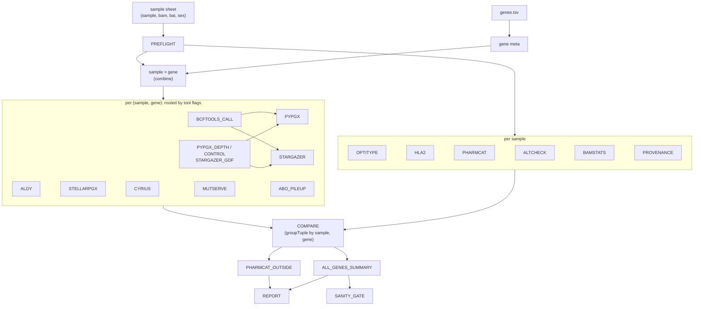

# pgx-suite: Snakemake to Nextflow DSL2 port plan

Status: **ported and validated** (see [Validation results](#validation-results)). Every Snakefile rule has a
Nextflow process; Snakemake stays the default engine, Nextflow is opt-in. Validated with image
`pgx-suite:211aa10`, Nextflow 25.10.4.

## Validation results

Code: `main.nf`, `modules/local/pgx.nf`, `nextflow.config`, `bin/` (the Snakefile's inline `run:` blocks
moved verbatim), comparison tool `tests/compare_runs.py`. One sample per run.

**Criterion:** Nextflow reproduces a Snakemake result: on every GIAB sample, all genes, its output equals a
Snakemake run of the same image file for file (`compare_runs.py`: 0 differences). Because some tools are
not reproducible run to run, Snakemake was run twice per sample.

| Sample | Nextflow vs Snakemake run 1 | vs run 2 | Snakemake run 1 vs run 2 | Wall time Snakemake 1 / 2 / Nextflow |
|---|---|---|---|---|
| HG001 | 0 differences | 0 | 0 | 1246 / 1282 / 1092 s |
| HG002 | 0 | 0 | 0 | 1340 / 1203 / 1075 s |
| HG003 | 0 | 0 | 0 | 1127 / 1183 / 860 s |
| HG004 | 0 | 0 | 0 | 1040 / 1007 / 956 s |
| HG005 | 0 | 0 | 0 | 1170 / 1023 / 917 s |
| HG006 | 0 | 0 | 0 | 1184 / 984 / 961 s |
| HG007 | 8 | **0** | 8 (the same 8 files) | 486 / 397 / 377 s |

Wall times: 16 CPUs per run, the Snakemake and Nextflow runs of a sample concurrently, two samples at a time.

Other checks (same image):

| Check | Result |
|---|---|
| Calls reported by OmniGen for HG001 to HG007 (2026-11-16 regeneration: actionable PGx genes, HLA class I and II, ABO) | Nextflow 75/75 match; Snakemake 74/75 (HG007 DQB1 third field, below) |
| Unit tests `docker/test_*.py` (13), `compare_runs.py --selftest` | pass |
| Truncated BAM | both engines stop before any caller (`PREFLIGHT` / startup check), exit 1 |
| Nextflow killed after 2 tasks, then `-resume` (smoke slice) | 2 tasks reused, rest rerun; 0 differences vs Snakemake |
| `-resume` with a different BAM / the same BAM (pilot) | 0 cached / all cached, outputs identical |
| Aldy forced to fail (slice) / OptiType forced to fail (WGS) (pilot) | identical on both engines; failed tool reported as `failed`, report written |

"Allowed" differences are tool nondeterminism, listed by `compare_runs.py`, never silently accepted. Each
class was seen between two Snakemake runs or between repeated runs of the tool outside any engine:
- PyPGx: the `VariantData` evidence column (calls unchanged).
- Stargazer: candidate-allele list order; Beagle step durations in its logs.
- OptiType: the ILP objective's last floating-point digit (alleles and read count compared exactly).
- arcasHLA: EM abundances and ranked pairs; allele order within a locus (HG001 B: 1 run in 10, also when
  the same Nextflow task was rerun three times). Its third-field call is **not** reproducible either: HG007
  DQB1 was `03:03:02/03:03:38` in Snakemake run 2, Nextflow and the earlier server run, `03:03:02/03:03:02`
  in Snakemake run 1 (two-field consensus `DQB1*03:03` in all). Call-level differences are never "allowed";
  they are why the criterion is "equals a Snakemake run".
- Aldy: equal-scoring solutions printed in either order (CYP2A6 on HG004: 3 of 11 runs outside any engine).
- mutserve: temp-folder name, progress bars and run time in its log.
- The PharmCAT cross-check race below (it also changes the NUDT15 note text on HG007).

Findings:
- **Snakefile race (not fixed; owner decision).** `pgx-compare.py` adds a PharmCAT cross-check to any gene
  if `pharmcat/pgx.report.json` already exists, but only `pharmcat`-flag genes declare that dependency. The
  port routes PharmCAT only to the declared genes, so it never adds it: deterministic, and the Snakemake
  output is one of its two possible outcomes.
- **Port bugs found and fixed during validation:** (1) values computed in helper functions are not part of
  a task's hash, so an early version reused one BAM's results for another on `-resume`; every process now
  takes the sample map as a declared input. (2) `REPORT` merged the summary tree after
  `PHARMCAT_OUTSIDE`'s, so a stale stage-1 `pharmcat/` overwrote the outside-call results;
  `PHARMCAT_OUTSIDE` now merges last. The 3-gene pilot could not show (2): none of its genes route PharmCAT.
- `-resume` does not notice a change that only reorders a process's input files (the merge order above);
  after changing the order in `main.nf`, run without `-resume`.
- Snakemake creates a rule's output folder before it runs; `COMPARE` does the same explicitly.

Not done: multi-sample runs (the COMPARE group key must include the sample); `run_pgx_suite.sh --engine`;
rootful/offline/SGE profiles; OmniGen `html`/`validate-pgx` on both trees; the open questions in section 7.

Goal: run pgx-suite on the same workflow engine as SVcaller and poly-suite (Nextflow), with a leaner
deployment, while producing **the same results** as the current Snakemake pipeline. The port is accepted
only if the equivalence gate in section 5 passes.

Legend used below: **[read]** = verified by reading code, configs or existing outputs; **[assumed]** = an
inference that still needs checking.

---

## 1. Current architecture (as read from `docker/Snakefile`)

### 1.1 Entry and runtime

- `run_pgx_suite.sh` (host) runs **one** `docker run --privileged --rm` of `pgx-suite:<tag>` with mounts
  `/pgx/stellarpgx`, `/pgx/containers` (SIFs + T1K index), `/pgx/bundle` (PyPGx bundle), `/pgx/ref:ro`,
  `/pgx/data:ro`, `/pgx/results`, then `snakemake -s /opt/pgx/Snakefile --cores $JOBS --config bam=... outdir=/pgx/results ref=/pgx/ref/hg38.fa sample=$SAMPLE`. **[read]**
- The sample id is the BAM file name up to the first `.` (wrapper); the Snakefile falls back to `@RG SM:`, then
  the basename. **[read]**
- Image: Ubuntu 22.04, two stages; venv with PyPGx (vendored `pypgx/`), Aldy 4.8.3, Snakemake 9.23.0; T1K
  built from a pinned commit; Stargazer 2.0.3 and Cyrius vendored; mutserve 2.0.3 jar; Apptainer from the PPA;
  Nextflow 25.10.4 (for StellarPGx); Java 21. About 1.95 GB. `/opt/pgx/VERSION` is stamped from a build arg. **[read]**
- Outside the image, as mounted assets: four Apptainer SIFs (`optitype.sif` 150 MB, `arcashla.sif` 470 MB,
  `pharmcat.sif` 1.86 GB, `stellarpgx-dev.sif` 32 MB), the T1K HLA index, the PyPGx bundle, and the StellarPGx
  checkout (upstream `SBIMB/StellarPGx`, DSL2, 12 processes). **[read]**

### 1.2 Why `--privileged`

Four tools run as **Apptainer inside Docker**, which needs the outer container privileged (mount namespaces,
squashfs/FUSE): **[read]**

| Rule | Nested container |
|---|---|
| `optitype` (`pgx-hla.sh`) | `apptainer exec optitype.sif OptiTypePipeline.py` |
| `hla2` (`pgx-hla2.sh`) | `apptainer exec --cleanenv arcashla.sif arcasHLA ...` (T1K runs natively in the image) |
| `pharmcat`, `pharmcat_outside` | `apptainer exec --cleanenv pharmcat.sif pharmcat_pipeline` / `java -jar pharmcat.jar -po` |
| `stellarpgx` | a nested `nextflow run /pgx/stellarpgx/main.nf` whose `nextflow.config` enables Singularity with `stellarpgx-dev.sif` |

Nothing else needs privilege. A side effect: in rootful Docker every output is root-owned, which is why the
OmniGen batch kit runs a `chown` container after each pgx stage.

### 1.3 Gene configuration and fan-out

`docker/genes.tsv` is the single source of truth: 44 rows, `CYPOR` is skipped as an alias of `POR`, so
**42 target genes**, optionally narrowed by `--config genes="..."`. Columns: `region`, per-tool flags (`pypgx`,
`stargazer`, `aldy`, `stellarpgx`, `optitype`, `mutserve`, `vcf_check`, `cyrius`, `pharmcat`, `arcashla`),
`pypgx_sv`, `stargazer_sv`, `stargazer_control`. `needs_vcf(g) = (pypgx or stargazer) and region != ALT_CONTIG`. **[read]**

### 1.4 Rules

| Rule | Level | Tool / script | Output (under `OUT=results/<S>/`) | Failure semantics |
|---|---|---|---|---|
| `_startup_checks()` | parse time | `samtools quickcheck`; contig of each target region in `ref.fai` | none | raises: whole run aborts |
| `bcftools` | gene | `bcftools mpileup -r region -a AD,DP --max-depth 500 \| call -m -v` + `tabix` | `genes/<g>/<g>.vcf.gz{,.tbi}`, `logs/bcftools.status` | non-fatal sentinel |
| `abo_pileup` | ABO | `abo_pileup.py` | `genes/ABO/abo_pileup.json` | fatal |
| `aldy` | gene | `aldy genotype -p illumina` | `genes/<g>/aldy/<g>.aldy`, `logs/aldy.status` | non-fatal |
| `stellarpgx` | gene | nested `nextflow run` (BAM glob `BAM_DIR/BAM_BASE*{bam,bai}`); deletes its `.work` | `genes/<g>/stellarpgx/<g>/...`, `logs/stellarpgx.status` | non-fatal |
| `optitype` | sample | `pgx-hla.sh` | `optitype/<S>_result.tsv`, `optitype/optitype.status` | non-fatal |
| `mutserve` | MT-RNR1 | `pgx-mt.sh` | `genes/MT-RNR1/mt-rnr1/...`, `logs/mutserve.status` | non-fatal |
| `hla2` | sample | `pgx-hla2.sh` (arcasHLA + T1K + `hla2_consensus.py`) | `hla2/<S>.genotype.json`, `<S>.t1k_genotype.tsv`, `<S>.hla2_consensus.json`, `hla2.status` | non-fatal, but loud on stderr |
| `pypgx_depth`, `pypgx_control` | gene (`pypgx_sv`) | `pypgx prepare-depth-of-coverage`, `compute-control-statistics VDR` | `genes/<g>/depth-of-coverage.zip`, `control-stats-VDR.zip` | **fatal** (hard deps) |
| `stargazer_gdf` | gene (`stargazer_sv`) | `stargazer -G` | `genes/<g>/stargazer_gdf/` | fatal |
| `pypgx_pipeline` | gene | `pypgx run-ngs-pipeline` | `genes/<g>/pypgx/`, `logs/pypgx.status` | non-fatal |
| `stargazer_genotype` | gene | `stargazer -t ... -i <g>.vcf.gz` | `genes/<g>/stargazer/`, `logs/stargazer.status` | non-fatal |
| `cyrius` | CYP2D6 | `star_caller.py --threads {threads}` | `genes/CYP2D6/cyrius/`, `logs/cyrius.status` | non-fatal |
| `pharmcat` | sample | `bcftools mpileup -R positions \| call -m` then `pharmcat_pipeline --missing-to-ref` | `pharmcat/*`, `pharmcat.status` | non-fatal |
| `altcheck` | sample | `pgx_altcheck.py` | `alt_aware.json` | fatal |
| `provenance` | sample | inline Python | `provenance.json` | fatal |
| `compare` | gene | inline: reads `*.status`, `samtools coverage` for region depth, alt-aware verdict, then `pgx-compare.py` | `genes/<g>/<g>_<S>_detail.json`, `_comparison.tsv`; for ABO also `abo/abo_type.{tsv,json}` (outside the gene dir) | fatal |
| `pharmcat_outside` | sample | `pgx-pharmcat-outside.sh` (needs HLA-A, HLA-B, CYP2D6 detail) | **edits in place**: `provenance.json` (+`pharmcat_outside_calls`), `pharmcat/pgx.report.json` (old copy kept as `pgx.report.no_outside.json`), `pgx.phenotype.json`, `outside_*`; `outside.status` | non-fatal |
| `all_genes_summary` | sample | inline Python; adds HLA2 columns | `all_genes_summary.tsv` | fatal on malformed or missing consensus when `hla2` succeeded |
| `bamstats` | sample | `pgx-bamstats.sh` (samtools, mosdepth) | `bam_stats.json` | fatal |
| `report` | sample | `pgx-report.py` | `<S>_pgx_report.html` | fatal |
| `sanity_gate` | sample | inline Python | `.sanity_ok`; exits 1 if over 60% of genes are no_call/no_data (the report is already written) | fatal by design |

All **[read]** from the Snakefile, scripts and an existing `results/HG002/` tree.

### 1.5 Status-file convention ("ERROR is never NEGATIVE")

- Every caller rule's declared output is a **sentinel** `logs/<tool>.status` that holds the real exit code. The
  shell always exits 0 (`cmd || rc=$?; echo $rc > status`), so one failing caller never stops the gene or the batch.
- `compare` turns any non-`0` sentinel into `--failed-tools PyPGx,...`. `pgx-compare.py` then globs whatever real
  outputs exist (`glob.glob` over `pypgx/`, `stargazer/`, `stellarpgx/<g>/alleles/*.alleles`, ...) and marks a
  tool `failed`, never `not_run` or wild type.
- Sample-level sentinels: `optitype/optitype.status`, `hla2/hla2.status`, `pharmcat/pharmcat.status`,
  `pharmcat/outside.status`. OmniGen's orchestrator also checks `hla2/hla2.status == 0` after the run.
- Fail-loud gates: startup checks, the hard SV prep steps, a malformed HLA2 consensus, and `sanity_gate`.

### 1.6 Resources

`threads`/`mem_mb` are declared on 8 rules (2 to 4 threads, 2 to 8 GB). Snakemake's `--cores $JOBS` is the only
limit actually enforced; `mem_mb` is not passed as `--resources`, so memory is not scheduled. Several scripts
size themselves with `nproc` (`pgx-hla.sh`, `pgx-bamstats.sh`), which inside Docker returns the host's CPU count.
**[read]** Run time per sample on the server: not measured here. **[assumed]** It is dominated by the
per-gene StellarPGx and PyPGx runs.

### 1.7 What OmniGen reads (the output contract)

**[read]** from `OmniGen/prototype` (`config.py`, `versions.py`, report modules, the batch orchestrator):
`all_genes_summary.tsv` (manifest key `pgx_summary`; the result folder is derived from it),
`genes/<g>/<g>_<S>_comparison.tsv`, `pharmcat/pgx.report.json`, `hla2/<S>.hla2_consensus.json`,
`abo/abo_type.tsv`, `provenance.json` (`pipeline`, `tools{}`), and `hla2/hla2.status`. OmniGen's tool-version
table already knows both a `snakemake` key and a `nextflow` key.

### 1.8 Things the port must not lose

- The existing `results/` trees are **not** a valid baseline. For example, `results/HG002/all_genes_summary.tsv`
  has 7 columns, while HEAD writes 10 (HLA2 columns), and today's MT-RNR1 and G6PD fixes postdate them. The
  baseline must be regenerated at `f1eeadb` (Phase 0).
- PyPGx `.zip` archives are not byte-reproducible. Each one wraps its members in a random `tmpXXXX/` directory
  and stamps zip mtimes. On HG002, the 10 per-gene `depth-of-coverage.zip` files have 10 different md5s but
  **identical member contents**. **[read]** So the comparison must look inside the archives.
- `stargazer_gdf/` contains a Snakemake `.snakemake_timestamp` marker. It will disappear, which is expected.

---

## 2. Target Nextflow DSL2 design

### 2.1 Layout

```
pgx-suite/
  main.nf                       # entry: params check, PREFLIGHT, calls PGX workflow
  nextflow.config               # manifest, params, profiles, trace/report (SVcaller style)
  conf/{base,docker,docker_rootful,offline,sge,test}.config
  workflows/pgx.nf              # PGX: fan-out, compare, sample-level finalisation
  subworkflows/gene_callers.nf  # per (sample, gene) caller fan-out
  subworkflows/hla.nf           # OPTITYPE + HLA2
  subworkflows/pharmcat.nf      # PHARMCAT + PHARMCAT_OUTSIDE
  modules/local/<tool>/main.nf  # one process per Snakefile rule (names below)
  bin/                          # symlinks to or moves of docker/*.py|*.sh (still COPYed into the image)
  docker/Snakefile              # kept read-only during the parallel-run period, then removed
```

`docker/genes.tsv` stays the single source of truth. The workflow parses it with
`channel.fromPath(params.genes_tsv).splitCsv(header:true, sep:'\t')` into a gene meta map
(`[gene, region, tools:[...], pypgx_sv, stargazer_sv, stargazer_control, is_alt, needs_vcf]`).
`test_genes_config.py` gains a check that the Nextflow parser and `pgx-compare.py` agree, as the Snakefile does today.

Process names map one to one: `PREFLIGHT`, `BCFTOOLS_CALL`, `ABO_PILEUP`, `ALDY`, `STELLARPGX`, `OPTITYPE`,
`MUTSERVE`, `HLA2`, `PYPGX_DEPTH`, `PYPGX_CONTROL`, `STARGAZER_GDF`, `PYPGX`, `STARGAZER`, `CYRIUS`, `PHARMCAT`,
`ALTCHECK`, `PROVENANCE`, `COMPARE`, `PHARMCAT_OUTSIDE`, `ALL_GENES_SUMMARY`, `BAMSTATS`, `REPORT`, `SANITY_GATE`.

### 2.2 Channels



- Input: `--input sheet.csv` (`sample,bam,bai[,sex]`), as in SVcaller. A single-sample shortcut
  (`--bam`, `--sample`, `--sex`) is kept so `run_pgx_suite.sh` stays a thin wrapper. Several samples per run
  work naturally, because every channel element carries `meta.id`.
- Fan-out: `ch_sample.combine(ch_genes)` gives `[meta_s, meta_g, bam, bai]`. Each caller subworkflow uses
  `.filter { it.meta_g.tools.contains('aldy') }` (and so on) to reproduce the `supports()` routing. The SV prep
  steps filter on `pypgx_sv` and `stargazer_sv`, and are joined to `PYPGX` and `STARGAZER` by `[sample, gene]`.
- The sample-level callers (`OPTITYPE`, `HLA2`, `PHARMCAT`, `ALTCHECK`) emit once per sample. They are
  `combine`d into `COMPARE` only for genes whose flag needs them (`optitype`, `arcashla`, `pharmcat`), as the
  `compare_inputs()` function does now.
- `COMPARE` gets one tuple per (sample, gene): all caller bundles (`groupTuple(by:[0,1], size: n_expected)`,
  where `n_expected` is computed from the gene's flags, so it never waits on a tool that will not run), plus the
  BAM, the reference and `alt_aware.json`.

### 2.3 Staging the per-gene tree for `pgx-compare.py`

`pgx-compare.py` globs a directory laid out as `genes/<g>/{pypgx,stargazer,aldy,stellarpgx,cyrius,mt-rnr1,logs}`
and, for ABO, writes to `../../abo/` relative to it. The port must give it **exactly that layout**, without
changing `pgx-compare.py`:

- Each caller process writes its outputs under `<tool>/...` plus `status/<tool>.status`, and emits
  `tuple val(key), path("<tool>"), path("status/<tool>.status")`. The output directory is declared
  `optional: true`, so a crashed tool's partial output still flows on, as Snakemake leaves it on disk.
- `COMPARE` rebuilds `S/genes/<g>/` with `cp -rL` (not symlinks: Python's recursive `glob` and symlinked
  directories are a known source of drift) and moves the sentinels into `S/genes/<g>/logs/`. It then runs the
  same inline logic (the failed-tools list, `samtools coverage` region depth, `alt_aware`, `--bam/--ref/--sex`).
  It emits `S/genes/<g>/**` and, for ABO, `S/abo/**`.
- The inline `run:` blocks (`compare`, `all_genes_summary`, `provenance`, `sanity_gate`) move **verbatim** into
  `bin/pgx_compare_wrap.py`, `bin/all_genes_summary.py`, `bin/write_provenance.py` and `bin/sanity_gate.py`, and
  are unit-tested. This is the main code change in the port; the logic itself is not rewritten.

### 2.4 Failed tool is not a negative: mapping to Nextflow

| Snakemake mechanism | Nextflow equivalent |
|---|---|
| Caller rule always exits 0 and writes `rc` to a sentinel | Same script body (`cmd \|\| rc=$?; echo $rc > status/<tool>.status`); `errorStrategy 'terminate'`. The task only fails for infrastructure reasons (OOM kill, container missing), and that **must** stop the run, because a tool that never ran must not become a "failed" verdict either. |
| Infrastructure kill (exit 137/140) | `errorStrategy { task.exitStatus in [137,140] && task.attempt <= 2 ? 'retry' : 'terminate' }` with `memory { base * task.attempt }`, as SVcaller's `DELLY_CALL_SVTYPE` does |
| Hard deps (`pypgx_depth`, `stargazer_gdf`, `altcheck`, `compare`, `bamstats`, `report`) fail the run | Default `terminate`, with no sentinel |
| Missing output = tool not run | Never inferred from a missing file. `COMPARE` only gets the tools the gene's flags route to, and checks that every expected sentinel is present (it aborts if one is not). |
| `hla2` stderr warning | Kept, and `HLA2` also emits `hla2.status` as a value channel, so `ALL_GENES_SUMMARY` gets the same "ran, but the consensus is missing" check |
| `sanity_gate` exit 1 after the report is written | `SANITY_GATE` depends on the summary only, never upstream of `REPORT`. Its failure fails the run after `REPORT` has published. `workflow.onError` prints the same message. |
| `_startup_checks()` at parse time | `PREFLIGHT` process (quickcheck plus contig check against `ref.fai`). Every BAM-consuming process takes its output (a `val ok`) as input, so no caller starts on a corrupt input. The contig check is also done in Groovy at launch for the fastest possible failure. |

### 2.5 In-place edits: `PHARMCAT_OUTSIDE` and provenance

Today, `pharmcat_outside` rewrites `provenance.json` and `pharmcat/pgx.report.json` in place. Nextflow tasks
must not change their inputs, and two publishes of the same path would race. Design:

- `PROVENANCE` and `PHARMCAT` emit their files **without** `publishDir`.
- `PHARMCAT_OUTSIDE` stages both, runs the unchanged `pgx-pharmcat-outside.sh` on a private copy of the
  `S/` tree, and emits the final `provenance.json` and `pharmcat/` directory. **Only these are published.**
- `REPORT` takes the final `provenance.json` from `PHARMCAT_OUTSIDE`, matching the Snakefile's dependency
  `report <- outside.status`.

### 2.6 Resume, caching, the work directory and publishing

- `-resume` replaces Snakemake's existing-output skip. That also fixes the OmniGen `--force` workaround: today
  the orchestrator moves the old results directory aside, because Snakemake reuses existing outputs. With
  Nextflow, a fresh `-work-dir` gives a full recompute.
- `cache = 'lenient'` (BAMs on shared storage get their mtimes changed by copies), as SVcaller should use too.
- The work directory goes on the node-local SSD scratch, passed with `-work-dir` by the caller. The BAM is read
  through a symlink (`stageInMode 'symlink'`), so no BAM copy is made. Published outputs go to shared storage.
- `publishDir "${params.outdir}/${meta.id}/...", mode: params.publish_mode` (default `copy`, because the work
  directory is deleted after success: `params.auto_cleanup` as in SVcaller). `saveAs` closures map each
  process's emitted paths onto the **exact** current tree (`genes/<g>/...`, `optitype/`, `hla2/`, `pharmcat/`,
  `abo/`, top-level files, `.sanity_ok`).
- The `pipeline_info/` trace, timeline and report go under `${outdir}/<S>/pipeline_info/`. This new subfolder is
  the only addition to the tree; OmniGen ignores unknown files.
- Not published: the `stellarpgx/.work` tree, which Snakemake already deletes (F8), and Nextflow's internal staging.

### 2.7 Params and profiles

```
params: input, bam, bai, sample, sex, outdir='results', ref, genes_tsv, genes (subset),
        min_depth=10, pypgx_bundle, stellarpgx_dir, containers_dir (SIFs + t1k_hlaidx),
        pgx_image='pgx-suite:<git-sha>', publish_mode='copy', auto_cleanup=false,
        max_cpus, max_memory, max_time        (same names and resourceLimits pattern as SVcaller)
profiles:
  docker          rootless or dev box: docker.enabled, mounts for bundle/SIF/ref
  docker_rootful  -u uid:gid -e HOME=/tmp, docker.fixOwnership=true (non-privileged processes);
                  privileged processes run as root and rely on fixOwnership
  offline         NXF_OFFLINE semantics: no pulls (docker.pullPolicy is not used), every image must be
                  loaded from a tarball first; the nested StellarPGx run gets -offline
  sge             executor 'sge', penv 'smp', clusterOptions from params (later; see section 4.4)
  test            a 3-gene subset on a mini BAM (the minibam/ fixture already in the repo)
```

Privileged processes are selected with `withLabel: 'nested_apptainer' { containerOptions = '--privileged' }`.
That way, in Phases 1 and 2, only `OPTITYPE`, `HLA2`, `PHARMCAT`, `PHARMCAT_OUTSIDE` and `STELLARPGX` are
privileged, instead of the whole pipeline (a strict improvement over today).

---

## 3. Container strategy

| Option | Image count / size | Offline nodes | `--privileged` | Equivalence risk |
|---|---|---|---|---|
| **A. Keep the monolith + SIFs** (one `pgx-suite` image used by every process, as now) | 1 image (1.95 GB) + 4 SIFs (2.5 GB) | unchanged: one tarball plus the SIF files | 5 processes | none; same binaries |
| **B. Monolith + SIFs turned into Docker images** (`optitype`, `arcashla`, `pharmcat`, `stellarpgx`) | 5 images; the SIFs go away. Built by `unsquashfs` of each SIF, then `tar` and `docker import`, so the image filesystem is **byte-identical** to what Apptainer ran | 5 tarballs (or one `docker save` of all 5, which dedups shared layers) | **none** (Apptainer leaves the image; the image shrinks) | low: same files, but Apptainer's `--cleanenv`, bind mounts and environment must be reproduced with `ENV`/`containerOptions` |
| **C. Per-tool images** (also split PyPGx, Aldy, Stargazer, Cyrius, T1K, mutserve) | 9 to 10 images; total size grows (each needs its own Python and samtools) | many artifacts to pin and transfer | none | medium: each split re-resolves Python, samtools and bcftools versions |

Licensing constrains C. Stargazer (UW non-commercial, "Distribution of the Software is not permitted"),
Aldy (IURTC non-commercial) and Cyrius (PolyForm Strict) cannot go into a public registry under any option.
Images stay **built locally and moved by tarball**, as today. Splitting gains nothing here, because the Python
callers share one venv. **[read]** from the bundled LICENSE and `docs/ToolsDocumentation.md`.

**Recommendation:** A for Phases 1 and 2, so the port proves engine equivalence and nothing else. Then B in
Phase 3, which removes `--privileged`, removes Apptainer from the image and the root-owned output workaround,
and keeps the artifact count the same (four SIF files become four image tarballs). Do not do C.

For StellarPGx under option B there are two routes:

1. **Vendor its 12 processes as a subworkflow** (`subworkflows/stellarpgx.nf`) run in the `stellarpgx` image.
   This removes nested Nextflow entirely, and the StellarPGx steps join resume and the trace. It costs a careful
   port of `$PWD`-relative paths and its `fromFilePairs` BAM glob, and a re-sync if upstream changes (upstream
   checkout is at `4cea5d9`, and the SIF was built from an unpinned `:latest` tag, so the shipped file is the pin).
2. **Keep the nested `nextflow run`**, but inside a `stellarpgx` image with Java and Nextflow added and
   `singularity.enabled=false`, so StellarPGx's processes run as plain local processes. This is smaller, but
   keeps a Nextflow-in-Nextflow black box.

I recommend route 1, but only after route 2 has proven B's equivalence for the other three tools.

---

## 4. Consistency with SVcaller and poly-suite

### 4.1 What the siblings do today **[read]**

- **SVcaller:** a native DSL2 pipeline (`main.nf` -> `workflows/svcaller.nf`, `subworkflows/`, `modules/`, `bin/`,
  `conf/{base,docker,local,test}.config`). `manifest.nextflowVersion '>=25.10.0'`; params `input`, `ref_fasta`,
  `outdir`, `max_cpus/max_memory/max_time` with `check_max`; trace, timeline, report and DAG under
  `${outdir}/pipeline_info/`; `workflow.onComplete` writes `provenance.json` via `bin/write_provenance.py`, which
  runs each tool's version command inside its own image and writes "not reported" otherwise; `auto_cleanup`.
- **poly-suite:** **not** a Nextflow pipeline of its own. `bin/run.sh` drives the external `pgscatalog/pgsc_calc`
  (pinned revision) with `-c conf/rootless.config` overrides, plus Python steps; `bin/provenance.py` writes its
  provenance.
- **OmniGen batch kit:** layers one shared `-c batch-centos7.config` (rootful `-u uid:gid`, `fixOwnership`,
  per-stage `executor.cpus/memory` from environment variables) on SVcaller and pgsc_calc. It calls pgx-suite
  through `run_pgx_suite.sh` with a separate set of Docker options. `NXF_VER=25.10.4` is pinned.

### 4.2 Proposed shared conventions (apply to pgx-suite now; adopt in the others when touched)

| Topic | Convention |
|---|---|
| Engine | `NXF_VER=25.10.4` (the version already pinned and baked into the pgx image); `manifest.nextflowVersion '>=25.10.0'`; strict-syntax clean (`nextflow lint`) |
| Inputs | `--input` sample sheet with `sample` as the first column; `--ref_fasta` (pgx-suite currently says `ref`; rename to `ref_fasta`, keep `ref` as an alias for one release); `--outdir` |
| Output | `${outdir}/<sample>/...`, `pipeline_info/` inside it |
| Limits | `max_cpus`, `max_memory`, `max_time` via `process.resourceLimits` (Nextflow 24+), replacing `check_max` everywhere |
| Profiles | `docker`, `docker_rootful`, `offline`, `sge`, `test`: same names in each repo, so the OmniGen batch config can stop overriding `docker.runOptions` per repo |
| Labels | `process_low/medium/high` plus `nested_apptainer` (pgx only, removed in Phase 3) |
| Provenance | `<outdir>/<sample>/provenance.json` with a common core: `pipeline`, `pipeline_commit`, `engine:{name,version}`, `generated_utc`, `sample`, `reference{path,bytes,n_contigs}`, `tools{}`, plus repo-specific keys. Written by a `bin/write_provenance.py` called from a final process (not `onComplete`, so that it is cached, resumable and published). The pgx keys OmniGen reads (`pipeline`, `tools`) keep their names. |
| Versions | each tool's version is reported by the tool inside its own container, never the repo's git sha (the OmniGen rule) |
| Logging | `NXF_ANSI_LOG=false` in batch; per-task `.command.log` stays in work; a status summary at `workflow.onComplete` |

### 4.3 How OmniGen calls all three

After the port, each of the OmniGen batch stages becomes the same shape (the change lives in the OmniGen repo):

```
nextflow run <repo>/main.nf -profile docker,docker_rootful,offline -c <batch.config> \
   --input <sheet.csv> --ref_fasta <ref> --outdir <repo>/results -work-dir <ssd>/<stage> -resume
```

- The pgx stage drops `fix_owner` (Phase 3) and the `--force` move-aside. `--force` becomes a fresh `-work-dir`.
- The "BAM file name must start with `<S>.`" constraint goes away, because the sample sheet names the sample.
  The wrapper keeps that rule as its default for backward compatibility.
- `deploy/Makefile`'s `pgx` target becomes `nextflow run` like the `sv` target next to it.
- `run_pgx_suite.sh` stays as the user-facing single-sample wrapper (`--engine nextflow|snakemake` during the
  parallel-run period), so the README quick start does not change.

### 4.4 A top-level suite workflow: later, not now

A `omnigen-suite/main.nf` that `include`s the three pipelines would remove the bash orchestration. It is not
worth it yet:

1. poly-suite is a bash driver around a remote pipeline (`pgsc_calc`), not includable DSL2.
2. The batch kit deliberately runs one SGE job per sample with local executors (SGE stability, shared nodes).
3. The three repos release independently, and pgx-suite is public.

Revisit once poly-suite has a DSL2 entry point and the SGE question is settled. The shared conventions in 4.2
are what make that later step mechanical.

---

## 5. Equivalence validation

### 5.1 Baseline

Phase 0 regenerates a frozen Snakemake baseline with the `pgx-suite:f1eeadb` image on the validation set:
GIAB HG001 to HG007, and the G6PD and MT-RNR1 reference standards. The current `results/` trees are stale
(section 1.8). Keep the baseline read-only, next to (not inside) `results/`.

### 5.2 Comparison tool: `tests/compare_runs.py` (new, Phase 0)

The tool walks both `results/<S>/` trees. It fails on any file that exists on only one side (apart from the
allow-list), then compares by file type:

| File | Comparison |
|---|---|
| `all_genes_summary.tsv`, `*_comparison.tsv`, `abo/abo_type.tsv`, `optitype/*_result.tsv`, `hla2/*.t1k_genotype.tsv`, `pharmcat/outside_calls*.tsv`, `alt_aware.json`, `.sanity_ok`, `*.status` | **byte-identical** |
| `*_detail.json`, `hla2/*.json`, `abo/*.json`, `pharmcat/pgx.{report,phenotype,match}.json` | parsed, **field-identical**, ignoring only timestamp keys found by the tool (for example PharmCAT's report date) |
| `*.vcf.gz`, `pharmcat/pgx*.vcf*` | decompressed body (non-`#` lines) byte-identical; header identical except `##bcftools_*Command` and `##fileDate` lines |
| PyPGx `*.zip` | member contents identical, **ignoring** the random `tmpXXXX/` directory prefix and zip mtimes |
| Aldy, Stargazer, StellarPGx, Cyrius and mutserve text outputs | byte-identical, apart from lines matching a short per-tool allow-list of path or time patterns, each justified when added |
| `provenance.json` | identical except `generated_utc`, `pipeline` (image tag), `tools.snakemake`, which becomes `tools.nextflow`, and `reference.path` (staged path) |
| `bam_stats.json` | numeric fields identical, `bam` path field excluded |
| `<S>_pgx_report.html` | identical after removing the "Generated" timestamp and the engine line |
| `.snakemake_timestamp`, `pipeline_info/` | expected only on one side |
| `optitype/*_coverage_plot.pdf` | presence only (PDFs embed creation dates) |

Ordering: TSVs are compared as written, without sorting. The summary is already sorted by file name in both
engines. A difference in row order is a **failure**, because OmniGen and humans read it in order.

Downstream check: run OmniGen `omnigen.py html` and `omnigen.py validate-pgx` on both trees. The rendered PGx
sections and the GeT-RM concordance table must be identical.

### 5.3 Determinism pre-check (before blaming the port)

Run the Snakemake baseline **twice** on HG002. Anything that differs between two Snakemake runs (for example
StellarPGx, or OptiType's ILP with `nproc`-dependent threads) is classed as tool nondeterminism. It goes on the
allow-list with a field-level rule, and is reported to you rather than silently allowed.

### 5.4 Go / no-go checklist

- [ ] Phase 0 baseline built at `f1eeadb`; the double run shows which outputs are nondeterministic
- [ ] `compare_runs.py` passes on all 7 GIAB samples and both reference standards (zero unexplained diffs)
- [ ] For every gene and sample: identical `verdict.status`, consensus diplotype and phenotype, per-tool status and per-tool diplotype
- [ ] Fault injection: kill Aldy for one gene (a bad binary on `PATH` via a test config) gives `failed` in the detail JSON, and the gene is not concordant wild type, exactly as in Snakemake under the same injection
- [ ] Fault injection: a truncated BAM stops the run in `PREFLIGHT`; a wrong-contig reference stops it at launch; a forced 70% no-call run gives exit != 0 with the report written
- [ ] Fault injection: arcasHLA failure gives `hla2.status != 0` and class II reported as failed; a missing consensus with status 0 aborts
- [ ] `-resume` after a mid-run kill finishes with identical outputs
- [ ] Runs offline (network disabled) on the rootful CentOS 7 profile and on Ubuntu rootless; output ownership is the submitting user's
- [ ] OmniGen `html` and `validate-pgx` outputs are identical on both trees
- [ ] Wall time is no worse than Snakemake at the same CPU budget (report the trace)
- [ ] `docker/test_*.py` and the new `bin/` unit tests pass; README, `CLAUDE.md`, `docs/CHANGES.md` and `docs/howto-add-a-gene.md` are updated

---

## 6. Phased migration

The estimates are focused engineering days for one developer with agent help. Each phase also needs the
validation runs' wall time, which is roughly a full-set pgx run (not measured here).

| Phase | Scope | Effort | Exit criterion |
|---|---|---|---|
| **0. Baseline + differ** | Rebuild the baseline at `f1eeadb` (double-run HG002); write `tests/compare_runs.py`; inventory the nondeterministic outputs | 1 to 1.5 d | baseline frozen; differ passes baseline against itself and flags an injected change |
| **1. Pilot: 3 genes** (recommended first step) | `main.nf` + modules for exactly the processes needed by **CYP2D6** (all 6 callers, SV prep, StellarPGx nesting, Cyrius), **G6PD** (VCF-Check, sex, BAM site depth) and **HLA-A** (sample-level OptiType, nested Apptainer). Monolithic image, `nested_apptainer` label, publishDir tree. Compare against Snakemake run with `--config genes="CYP2D6 G6PD HLA-A"` on HG002 | 2 to 3 d | differ is clean for the 3 genes; fault-injection rows pass for Aldy and OptiType |
| **2. Full parity** | Remaining processes (`PHARMCAT`, `PHARMCAT_OUTSIDE`, `HLA2`, `MUTSERVE`, `ABO_PILEUP`, `BAMSTATS`, `REPORT`, `SANITY_GATE`, `PROVENANCE`); profiles `docker_rootful` and `offline`; `run_pgx_suite.sh --engine`; the full validation set; docs | 3 to 4 d | whole checklist in 5.4 is green; Nextflow becomes the default and Snakemake is kept one release as a fallback |
| **3. De-privilege** | SIF to Docker images (option B); remove Apptainer from the image; StellarPGx route 2, then route 1; re-validate the full set | 3 to 5 d | no `--privileged` anywhere; differ clean; image smaller |
| **4. Suite consistency** (in each repo, by its own agent) | shared profiles and provenance core in SVcaller; OmniGen batch kit calls all three the same way; optional: compute the per-gene-identical `depth-of-coverage.zip` / `control-stats-VDR.zip` **once per sample** (contents verified identical across genes on HG002), which saves about 9 BAM passes per sample | 2 to 3 d | OmniGen batch end-to-end identical reports |

Total: about 11 to 16 days of work, plus validation compute.

### Risks

1. **StellarPGx nesting (high).** Nested Nextflow with Singularity inside a Nextflow task inside Docker. It needs
   privilege, its own `NXF_HOME`, offline mode and a writable work directory; today the Snakefile deletes that
   work directory. Its BAM glob `BAM_BASE*{bam,bai}` can also pick up sibling files in the BAM directory today.
   Staging just the BAM and index in the task removes that, which could be a **legitimate output change** on a
   sample whose directory holds similarly named BAMs. The differ will show it; decide case by case.
2. **Privileged containers on the rootful server (medium).** In Phases 1 and 2, Nextflow's `-u uid:gid` cannot
   apply to the Apptainer processes (Apptainer inside an unprivileged, non-root container fails). Those 5
   processes run as root with `docker.fixOwnership`. That needs checking on Docker 18.06 / CentOS 7, which
   already requires `seccomp=unconfined` for other images. Phase 3 removes the issue.
3. **Hidden nondeterminism or environment drift (medium).** `nproc`-sized threads (OptiType, bamstats); Apptainer
   `--cleanenv` versus Docker environment (the `JAVA_HOME` leak already documented in the Snakefile's PharmCAT
   rule); a different `TMPDIR` (`mktemp -d` in `pgx-hla.sh` and `pgx-bamstats.sh`); `cp -rL` versus in-place
   globbing in `pgx-compare.py`. Mitigation: the Phase 0 double run, and fixed `task.cpus` matching the
   Snakefile `threads`.
4. **Licensing (low for the port, a hard constraint for distribution).** Stargazer, Aldy and Cyrius must stay in
   locally built images. No registry push in any phase. The public repo ships only build recipes, as now.
5. **CentOS 7 limits (low, temporary).** Nextflow 25.10.4 with Java 17 already runs there for SVcaller; Docker
   18.06 lacks newer `--cpus`/cgroup v2 features (Nextflow's local executor does not rely on them). Ubuntu is
   the real target; CentOS 7 is a smoke test only.
6. **In-place mutation (low).** `pharmcat_outside` rewrites `provenance.json` and the PharmCAT report. Handled
   by the publish-once design in 2.5; a mistake there would show up as a provenance or report diff.

### What to do first

Phase 0, then the **3-gene pilot (Phase 1)**. CYP2D6, G6PD and HLA-A between them exercise every hard
part: the SV prep hard dependencies, all six star-allele callers, Cyrius, nested StellarPGx, a nested-Apptainer
sample-level tool feeding several genes, the VCF-Check and sex path, and the per-gene staging for
`pgx-compare.py`. The Snakefile's existing `genes=` subset makes the baseline for exactly those genes cheap.
If the pilot's differ is clean, the rest is mostly mechanical.

---

## 7. Open questions

1. **Fallback window.** Keep the Snakefile as `--engine snakemake` for one tagged release after Phase 2, or delete it once Phase 2 passes?
2. **Phase 3 scope.** Is removing `--privileged` (SIFs to Docker images) a goal for the first server release, or can production run Phase 2 (5 privileged processes) first?
3. **StellarPGx.** Is vendoring its processes (route 1) acceptable, given it then diverges from upstream `SBIMB/StellarPGx`, or should it stay a nested black box (route 2)?
4. **Rename `ref` to `ref_fasta`** and adopt the sample-sheet `--input` across the suite, so pgx-suite stops naming samples from the BAM file name?
5. **Nondeterminism policy.** If the double Snakemake run shows a tool is not reproducible run to run (for example OptiType), is a field-level match on the called alleles acceptable for that tool?
6. **SGE executor.** Stay with "one SGE job per sample, local executor" (today's choice), or should the Nextflow port also ship an `sge` profile that submits per-task jobs on the new Ubuntu server?
7. **Per-sample dedup of the PyPGx depth/control archives** (Phase 4): their contents are identical across genes, so computing them once is byte-safe at the member level. Do it in this port, or as a separate change after equivalence?
8. **Validation set for the reference standards.** Which G6PD and MT-RNR1 reference samples are in scope for the gate? They need to be listed in the private validation notes, not here.
